# Student Management · Веб-программирование

Учебный проект команды **Geeks**: система управления студентами общежития. Участники — **Артём Мастеров** и **Андрей Сырчин**.

В репозитории собраны реализации лабораторных №1–5, документация и лекции курса.

## Реализованные лабораторные

| Работа | Стек | Что реализовано |
| --- | --- | --- |
| №1 — интерфейс | HTML, CSS, JavaScript | Список и карточка студента, добавление, редактирование, удаление, клиентская валидация и адаптивность. На первом этапе данные хранились в cookies. |
| №2 — сервер и API | Python, Django, Django REST Framework | REST API, серверная валидация, фильтрация, единый формат ошибок и JSON-хранилище. Интерфейс переведён на запросы к серверу. |
| №3 — Java backend и БД | Java 17, Spring Boot, Spring Security, EclipseLink/JPA, PostgreSQL | Регистрация, вход по JWT access/refresh, выход и роли USER/ADMIN; CRUD студентов, фильтры, сортировка, пагинация, Swagger и автоматические тесты. |
| №4 — Vue frontend | Vue 3, Vite, Vue Router, Pinia, RxJS | Вход, регистрация, профиль и защита маршрутов; список, карточка и CRUD с учётом ролей; поиск с задержкой и отменой запросов, фильтры, сортировка, пагинация, состояния загрузки/ошибок и адаптивность. Добавлен Docker Compose для frontend, Java backend и PostgreSQL. |

Лабораторные №1–2 объединены в одной папке: текущая версия работает через Django API. Лабораторная №4 использует Java backend из №3. Поиск текстовых полей в текущем Java API выполняется по точному совпадению; профиль предоставляет имя пользователя и роль.

Лабораторная №5 переносит интерфейс на Nuxt 4, Vue 3 и TypeScript: SSR, файловая маршрутизация, серверный транспорт к Java API, JWT в HttpOnly-cookie и кеш данных с обновлением после CRUD.

## Архитектура проекта

Актуальный интерфейс находится в `5 lab`: Nuxt выполняет серверный рендеринг страниц и служит промежуточным сервером между браузером и Java API. Лабораторная №4 сохраняет отдельную Vue-реализацию интерфейса, а №1–2 — раннюю версию с Django и JSON-хранилищем.

```mermaid
flowchart LR
    Browser[Браузер] -->|Страницы и /api/backend| Nuxt[Nuxt: SSR и серверный транспорт]
    Nuxt -->|REST /api, Bearer JWT| Security[Spring Security]
    Security --> Controllers[Контроллеры auth и student]
    Controllers --> Services[Сервисы: авторизация и студенты]
    Services --> Repositories[Репозитории Spring Data JPA]
    Repositories --> EclipseLink[EclipseLink]
    EclipseLink --> DB[(PostgreSQL)]
```

| Слой | Где находится | Ответственность |
| --- | --- | --- |
| Страницы и компоненты | `5 lab/app/pages`, `app/components`, `app/layouts` | Интерфейс, формы, список и карточка студента; файловая маршрутизация |
| Состояние и загрузка | `5 lab/app/composables` | `useAuth`, `useApi`, `useStudents`; получение данных при SSR, кеш списка и карточек на 30 секунд, обновление после CRUD |
| Доступ к страницам | `5 lab/app/middleware` | Перенаправление гостей и проверка роли для интерфейса |
| Сервер Nuxt | `5 lab/server/api/backend`, `server/utils/java.ts` | Передача запросов к Java, HttpOnly-cookie с токенами, обновление сессии и перенос cookie из SSR-ответа |
| Java API | `3 lab/src/main/java/dev/geeks/studentmanagement` | Пакеты `auth` и `student`: контроллеры, DTO, сервисы, модели и репозитории; `security` и `config`: JWT и права доступа; `common`: единые ошибки |
| Хранение | PostgreSQL через JPA/EclipseLink | Студенты, пользователи и refresh-сессии |

При открытии списка Nuxt получает данные через Java API и включает их в HTML; `useAsyncData` передаёт результат в браузер для гидратации. Последующие запросы браузера идут на `/api/backend` своего origin. Nuxt читает JWT из HttpOnly-cookie и передаёт access-токен в Java как `Authorization: Bearer …`.

Java проверяет JWT и роль: USER читает студентов, ADMIN также создаёт, изменяет и удаляет записи. Ограничения интерфейса дополняют серверную проверку прав. Токены не передаются в клиентское состояние. Персональные страницы получают `Cache-Control: private, no-store`; кеш данных принадлежит текущему Nuxt-приложению, а его ключи включают пользователя. Координация параллельного refresh рассчитана на один процесс Nuxt; для нескольких реплик требуется общая координация сессий.

Описание запуска и подробности Nuxt-реализации: [README лабораторной №5](5%20lab/README.md).

## Где искать код и запуск

| Каталог | Содержимое | Инструкция |
| --- | --- | --- |
| [1-2 lab](1-2%20lab/) | Интерфейс и Django backend, JSON-хранилище | [Запуск и описание](1-2%20lab/README.md) |
| [3 lab](3%20lab/) | Java backend, PostgreSQL, браузерный интерфейс, тесты и API-коллекции | [Настройка и запуск](3%20lab/README.md) |
| [4 lab](4%20lab/) | Vue-приложение, Docker Compose и миграция старой схемы refresh-сессий | [Локальный запуск и Docker](4%20lab/README.md) |
| [docs](docs/) | Описание первых работ и архив исходного README | [Лабораторные №1–2](docs/labs-1-2.md) |
| [5 lab](5%20lab/) | Nuxt frontend с SSR, серверным транспортом и тестами | [Запуск, архитектура и проверки](5%20lab/README.md) |
| [lectures](lectures/) | Презентации курса в PDF | [Каталог лекций](lectures/README.md) |

Настройки окружения описаны в README соответствующей работы. Настоящие `.env`, пароли, JWT-ключи и дампы с персональными данными не публикуются; для настройки используются безопасные `.env.example`.

## Требования и подготовка к защите

| Материал | Где находится |
| --- | --- |
| Описание целей и реализации лабораторных №1–2 | [docs/labs-1-2.md](docs/labs-1-2.md) |
| Возможности, API и проверки лабораторной №3 | [README №3](3%20lab/README.md) |
| Конспект по 16 вопросам к защите №3 | [DEFENSE.md №3](3%20lab/DEFENSE.md) |
| Возможности, ограничения и проверки лабораторной №4 | [README №4](4%20lab/README.md) |
| Краткая памятка к защите №4 | [DEFENSE.md №4](4%20lab/DEFENSE.md) |
| Подключение к уже организованной общей PostgreSQL | [SHARED_DATABASE.md](3%20lab/SHARED_DATABASE.md) |

Отдельные файлы с исходными ТЗ в репозитории пока отсутствуют. Описания реализации и конспекты помогают ориентироваться в выполненной работе, но не заменяют официальные задания преподавателя. Результаты проверок и ограничения указаны в документации самих работ.

## Лекции и материалы курса

В [lectures/README.md](lectures/README.md) собраны ссылки на **лекции 1–7**, отдельные презентации по **REST** и **Docker**. PDF можно просматривать на GitHub или скачивать. Авторство материалов принадлежит преподавателям, сведения об авторах сохранены в файлах.

## История проекта

Проект перенесён из [geek-masters/web2026-geeks](https://sourcecraft.dev/geek-masters/web2026-geeks). [Исходный README](docs/source-readme.md) сохранён как архив: он описывает раннее состояние проекта, а актуальные реализации перечислены выше.
